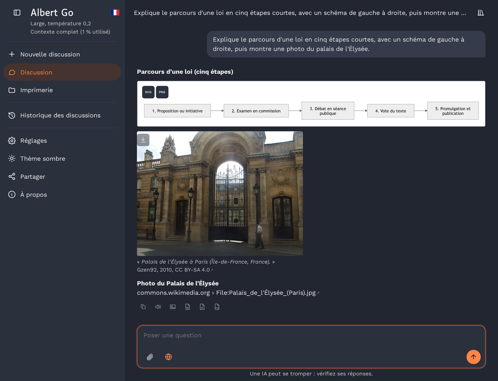

# Albert Go


[](https://github.com/obook/albert-go/releases)

[](https://obook.github.io/albert-go/)


Chatbot minimal pour [Albert](https://ia.numerique.gouv.fr/outils-ia/albert-api/), l'IA de l'État portée par la DINUM.

<p align="center"></p>

Albert Go s'utilise :

- en ligne, sur [Pages](https://obook.github.io/albert-go/) : chacun saisit sa clé API, gardée dans le navigateur ; le relais n8n de l'incubateur de l'Éducation nationale transmet les questions à Albert ;
- en serveur centralisé, sur un poste du réseau : le serveur Python garde la clé API et relaie les questions vers Albert ;
- sur une clé USB : la version autonome des [releases](https://github.com/obook/albert-go/releases) embarque ce serveur et Python.

Le mode d'emploi est dans la notice : [docs/documentation.pdf](docs/documentation.pdf) (installation, discussion, Imprimerie, outils, kiosque, dépannage).

## Lancer le serveur

```bash
./local.sh                # http://localhost:8913, ouvre le navigateur
./local.sh --no-browser   # sans ouvrir le navigateur
./local.sh --ssl          # HTTPS, certificat auto-signé
./local.sh --kiosque      # kiosque : un poste maître, des postes invités (ALBERT_KIOSQUE=oui dans .env)
```

```bash
cp .env-exemple .env      # puis coller la clé API après ALBERT_API_KEY=
```

`.env` reste dans le dossier du dépôt, ignoré par git ; le terminal affiche au lancement le fichier utilisé. Installation d'un serveur centralisé, avec démarrage automatique et mise à jour : [docs/DEPLOIEMENT.md](docs/DEPLOIEMENT.md). Pour créer une clé : [page d'Albert API](https://ia.numerique.gouv.fr/outils-ia/albert-api/).

## Fonctionnement

Sur un serveur, la page passe par lui : il ajoute la clé et relaie la requête vers Albert. Sur Pages, sans le `serveur.js` qu'écrit le serveur, la page envoie la clé de l'utilisateur au relais n8n (`public/js/albert.js`).

```
Serveur :  Navigateur -> serveur d'Albert Go -> API Albert
En ligne : Navigateur -> relais n8n -> API Albert
```

- `serveur/` : le serveur Python (relais, configuration, régulation du débit par modèle), repris de L'Atelier d'Albert.
- `public/` : la page (HTML, CSS, JavaScript), servie par le serveur ou publiée sur Pages, avec les bibliothèques embarquées dans `public/vendor/`.
- `public/pages/` : menus et boîtes de dialogue, un fichier par élément. `public/js/socle/chargement.js` les place dans `index.html`, puis charge les scripts dans l'ordre.
- `public/js/albert.js` et `public/js/albert/` : le client de l'API Albert.
- `public/js/socle/` : stockage, thème, langue et version, utilisés par tous les autres scripts.
- `public/js/interface/` : écrans, menu, réglages et saisie de la clé.
- `public/js/conversation/` : envoi des questions, réponses, historique et lecture à voix haute. `app.js`, chargé en dernier, lance l'application.
- `public/js/bibliotheque/` : documents déposés et fichiers joints.
- `public/js/modules/` : modules du menu (Discuter, Reformuler, Rédiger...).
- `public/js/kiosque/` : page de connexion du kiosque et mode partagé.
- `public/js/rendu/` : le rendu des réponses (schémas, courbes, images) et leur export : `export.js` parcourt la réponse affichée, `docx.js` et `odt.js` écrivent le fichier.
- `public/js/tools/` : les outils proposés au modèle (calculs, jours ouvrés, recherche web, images de Commons, services de l'État).
- `n8n/albert-proxy.json` : le relais n8n de la version en ligne, installation dans `n8n/README.md`.

Albert Go est un harnais agentique limité : dans Discussion, le modèle choisit un outil, la page l'exécute et lui rend le résultat, deux tours au plus (`public/js/tools/recherche/outils-modele.js`). Les outils, activés dans Réglages, lisent ou calculent sans rien modifier.

## Développement

```bash
./local.sh     # lance le serveur sur http://localhost:8913 et ouvre le navigateur
python3 -m http.server 8642 -d public    # la version en ligne, sans serveur (origine acceptée par le relais n8n)
node --test    # tests de la page
.venv/bin/python -m pytest    # tests du serveur (.venv créé par local.sh)
node --test tests/ipad.webkit.js    # la page dans WebKit, le moteur de l'iPad (Playwright, voir l'en-tête du fichier)
outils/images-lancement.sh    # refait les images de lancement iOS (nouvel écran : une ligne dans ECRANS)
```

GitHub lance ces tests à chaque pull request (`.github/workflows/tests.yml`). Un manque relevé sur un vrai iPad s'ajoute à `SAFARI_ANCIEN` dans `tests/ipad.webkit.js` : le WebKit de Playwright est plus récent que Safari sur un iPad pas à jour.

### Traductions

- `public/js/langues/<langue>.js` : tout le texte visible, un fichier par langue, plus les phrases envoyées au modèle (demandes des outils, description de l'outil de recherche). Dans `index.html` et `public/pages/`, un texte porte `data-t`, `data-t-html` (texte avec un lien) ou `data-t-attr` (`aria-label`, `title`, `placeholder`...), relus par `I18n.appliquer()` (`public/js/socle/i18n.js`). `tests/i18n.test.js` vérifie qu'aucune langue n'oublie de clé.
- `public/prompts/<langue>/*.txt` : les consignes système, une par outil et par langue.

Ajouter une langue : un code dans `I18n.LANGUES`, son fichier `public/js/langues/<code>.js` chargé dans `index.html`, un dossier dans `public/prompts/`, sa table dans `Lecture.FORMULES`, son drapeau et son option dans `index.html` et le domaine Wikipédia dans la CSP.

## Sécurité

Audit, modèle de menaces et plan d'action : [docs/SECURITE.md](docs/SECURITE.md).

- Sur un serveur, la clé API reste dans le fichier `.env` : la page ne la voit jamais. En ligne, la clé saisie reste dans le navigateur et ne part que vers le relais n8n, qui ne l'enregistre pas.
- Conversations, documents et bibliothèque restent dans le navigateur, effacés à la fermeture de l'onglet sauf si l'utilisateur choisit de les garder.
- La page ne charge aucun script externe, limite ses connexions par une politique CSP et assainit le HTML des réponses d'Albert.

## Accessibilité

La page vise la conformité [RGAA](https://accessibilite.numerique.gouv.fr/), sans audit à ce jour : tout se fait au clavier et les lecteurs d'écran annoncent les nouveaux messages ; le texte garde un contraste d'au moins 4,5:1 dans les deux thèmes.

## Auteur

Olivier Booklage, [olivier.booklage@ac-bordeaux.fr](mailto:olivier.booklage@ac-bordeaux.fr)

Le serveur et le kiosque viennent de L'Atelier d'Albert, écrit par Romain P., Luce P.B. et Théossian S.D. (Trophées NSI 2026).

## Licences

| Composant | Licence |
|---|---|
| Albert Go | GPL 3.0 ou ultérieure, texte dans `LICENSE` ; le serveur reprend le code de L'Atelier d'Albert, écrit par Romain P., Luce P.B. et Théossian S.D. (Trophées NSI 2026) |
| [Marked](https://github.com/markedjs/marked), [KaTeX](https://katex.org/), [Mermaid](https://mermaid.js.org/), [Pico](https://picocss.com/), [qrcode-generator](https://github.com/kazuhikoarase/qrcode-generator) | MIT |
| [PDF.js](https://mozilla.github.io/pdf.js/), [math.js](https://mathjs.org/) | Apache 2.0 |
| [highlight.js](https://highlightjs.org/) | BSD 3-Clause |
| [Giac](https://www-fourier.univ-grenoble-alpes.fr/~parisse/giac_fr.html), le moteur de calcul formel de Xcas | GPL 3.0 ou ultérieure, texte dans `public/vendor/giac/LICENSE` |
| Icônes des titres des Réglages et de la boîte Empreinte, de [Lucide](https://lucide.dev/) | ISC |
| Logos des éditeurs de modèles (`public/images/editeurs/`) | Marques de leurs éditeurs, reprises de la [page des modèles d'Albert API](https://ia.numerique.gouv.fr/outils-ia/albert-api/mod%C3%A8les/) |
| Logos des moteurs de recherche (`public/images/moteurs/`) | Marques de leurs éditeurs, reprises de leurs sites ; OpenAlex depuis [Wikimedia Commons](https://commons.wikimedia.org/wiki/File:OpenAlex_logo_icon.svg) (MIT) |

Les sources de Giac sont sur le site de son auteur : [giac_stable.tgz](https://www-fourier.univ-grenoble-alpes.fr/~parisse/giac/giac_stable.tgz).

Versions et provenance des bibliothèques : `public/vendor/README.md`.
